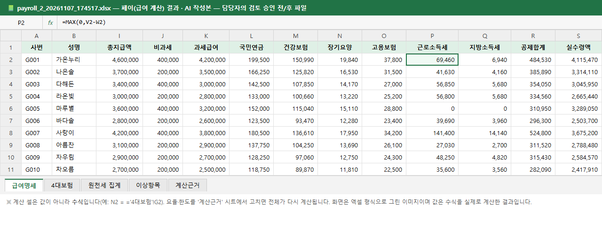

# 🏢 AI 오피스

> 통합세무(아웃소싱 회계·세무) 업무를 모델로, 가상 사무실에서 **AI 직원 5명**이 반복 업무를 처리하고 **최종 확정은 담당자가 검토 승인**하는 Human-in-the-loop 웹앱입니다.


*실제 서버에서 가상 샘플 데이터로 「월마감 시작」을 돌려 녹화한 화면입니다(1.6배속, 약 30초). 월마감 시작 → 직원들이 자리에서 **일하는중** → 전원 **검토필요** → 담당자 **승인** → **완료**.*

> ⚠️ **모든 회사·인물·거래는 가상 데이터**이고, 계산 결과는 포트폴리오 시연용입니다. 실제 신고·납부에 쓰는 도구가 아닙니다. 법령 수치는 `app/rules/` 에서 근거 조문·확인일과 함께 관리합니다(아래 "수치 검증 과정").

---

## 1. 담당업무 ↔ AI 직원

통합세무팀이 매달 반복하는 업무를 5개 영역으로 나눠, 영역마다 AI 직원을 한 명씩 두었습니다.

| 담당업무 | 반복 업무 | AI 직원 | AI가 하는 일 (작성·검증·대사) | 담당자가 하는 일 (판단·승인) |
|---|---|---|---|---|
| 급여·원천세 | 급여 계산, 4대보험, 원천세 신고 | 💰 **페이** | 급여명세·4대보험·원천세(근로·사업·기타소득) 계산, 원천징수이행상황신고서 집계, 이상항목 표시 | 이상항목 확인, 계산 결과 승인 |
| 기장·결산 | 분개, 시산표, 은행·카드 대사, 결산 | 📒 **북키** | 분개 추천(신뢰도 낮으면 **확인필요**), 분개장→원장→시산표, 은행 Reconciliation, BS 계정 검토, 결산 체크리스트·PBC | 확인필요 분개 확정, 원인불명 차이 규명 |
| 부가세 | 세금계산서 대사, 신고서 작성 | 🧾 **배트** | 세금계산서↔장부 4분류 대사, 불공제 매입세액 **후보** 표시, 신고서 요약, 발급기한·가산세 위험 안내 | 불공제 여부 판단, 불일치 원인 처리 |
| 법인세 | 세무조정, 세무조사 대비 | 🏛️ **코택** | 세무조정 검토표, 기업업무추진비 한도·인정이자·대손충당금 추정, 요청자료 목록 트래킹 (북키 시산표를 이어받음) | 세무조정 확정, 자료 준비 |
| 업무관리 | 월마감 배분, 신고기한 관리 | 📁 **매니저** | 월마감 업무 배분(페이→북키→배트→코택), 신고기한 캘린더(주말·공휴일 순연), 진행 현황 | 우선순위·일정 판단 |

---

## 2. 화면

| 오피스 뷰 (기본 화면) | 캐릭터 클릭 → 패널에서 검토·승인 |
|---|---|
|  |  |
| 픽셀아트 사무실. 직원이 일하는 동안 자리에서 키보드를 치고, 끝나면 머리 위에 **!** 가 뜹니다. 위쪽에 신고기한 D-day, 오늘 처리·검토 대기·오류 건수, 법령 수치 현황이 보입니다. | 직원을 클릭하면 작업 실행, 이상항목 요약, 결과 엑셀 내려받기, **담당자 이름·코멘트와 승인/반려**(반려는 사유 필수)를 한 곳에서 할 수 있습니다. |

| 법령 자료실 (책장) — 미확인 0 | 결과 엑셀 (수식이 살아 있음) |
|---|---|
|  |  |
| rules 의 모든 수치를 값·근거 조문·적용연도·확인일로 보여 줍니다. **🔴 미확인 0 / 🟠 외부자료 반입 필요 4**. | 페이 결과 파일의 `급여명세` 시트. 계산 셀은 값이 아니라 **수식**이고, `계산근거` 시트의 요율을 고치면 전체가 다시 계산됩니다. 이 그림은 엑셀 형식으로 렌더링한 이미지이며 값은 수식을 실제로 계산한 결과입니다. |

기존 카드형 화면은 `/list` 에서 볼 수 있습니다(상단 [오피스 뷰 | 목록 뷰] 버튼).

---

## 3. 실행 방법

**Windows (가장 쉬운 방법)**: 처음 한 번만 설치한 뒤, `run_office.bat` 을 더블클릭하면 서버와 브라우저가 한 번에 열립니다.

```bash
python -m venv .venv
.venv\Scripts\pip install -r requirements.txt
```

```bash
run_office.bat
```

직접 실행하려면 (주소: http://localhost:8000):

```bash
.venv\Scripts\python.exe -m uvicorn app.main:app --reload
```

테스트:

```bash
.venv\Scripts\python.exe -m pytest
```

> 오피스 뷰는 파일을 직접 열면(file://) 동작하지 않습니다. 반드시 서버로 접속하세요. 창이 좁으면(768px 미만) 목록 뷰로 자동 이동합니다.

**써 보기**: 오피스 뷰에서 「매니저」를 클릭 → 고객사 선택 → 「월마감 시작」. 샘플 고객사는 (주)가나상사(제조, 직원 16명)와 (주)다라테크(IT, 직원 8명)이고, 오류·대사 불일치 데이터가 일부러 섞여 있습니다. 상단의 `▶ 데모` 버튼은 서버와 무관한 시연용 애니메이션입니다.

---

## 4. 폴더 구조

```
ai-office/
├─ app/
│  ├─ main.py          # FastAPI 진입점
│  ├─ routes.py        # API (작업 실행·검토 승인·법령 자료·캘린더·진행 현황)
│  ├─ core/            # 상태(state)·작업큐(queue)·이벤트(SSE)·DB·규칙 로더·신고기한 계산
│  ├─ agents/          # BaseAgent + payroll / bookkeeping / vat / corptax / manager
│  ├─ rules/2026/      # 법령 기반 수치(YAML·CSV) — 항목마다 근거·확인일 (적용연도별 폴더)
│  └─ static/          # 오피스 뷰(office.html + office/*.js), 목록 뷰, 에이전트 상세
├─ sample_data/        # 가상 고객사 샘플 (급여대장·거래내역·세금계산서·시산표)
├─ scripts/            # 간이세액표 변환, 법령 확인표 출력
├─ docs/
│  ├─ rules_check.md   # 법령 수치 확인표 (근거·확인일·상태 90개 항목)
│  ├─ interview_notes.md  # 핵심 로직 3가지 설명 (비전공자용)
│  ├─ sources/         # 원본 자료 (홈택스 근로소득 간이세액표 엑셀)
│  └─ images/          # README 이미지
├─ tests/              # pytest
└─ CLAUDE.md           # 프로젝트 규칙·결정 사항·진행 기록
```

## 5. 사용 기술

Python 3.11+ · FastAPI · pandas · openpyxl(엑셀 수식 유지) · SQLite(SQLAlchemy) · asyncio 작업 큐 · SSE 실시간 갱신(끊기면 2초 폴링) · 단일 HTML + Tailwind CDN + 바닐라 JS/Canvas(빌드 도구 없음) · pytest · formulas(엑셀 수식을 파이썬 계산과 셀 단위로 비교)

---

## 6. 설계 원칙: Human-in-the-loop

**AI는 작성·검증·대사까지만 하고, 최종 확정은 담당자의 「검토 승인」입니다.**

- **책임은 사람에게 있습니다.** 세무 신고의 판단과 책임은 담당자가 집니다. AI가 만든 결과는 항상 `검토필요` 상태에서 멈추고, 승인 없이는 `완료`가 되지 않습니다.
- **AI가 틀릴 수 있다는 전제로 설계했습니다.** 분개 추천은 신뢰도가 낮으면 스스로 확정하지 않고 「확인필요」로 표시합니다. 불공제 매입세액도 "후보"일 뿐 판단은 담당자가 하며, 그 판단을 바꾸면 신고서 요약이 수식으로 즉시 다시 계산됩니다.
- **흔적이 남습니다.** 승인·반려는 담당자 이름·시각·코멘트가 DB에 기록되고, 반려할 때는 사유가 필수입니다. 반려하면 재작업(일하는중으로 복귀)이나 오류 처리를 고릅니다.
- **상태 변경 통로는 하나입니다.** 모든 에이전트는 공통 `BaseAgent` 를 상속하고 `set_status()` 로만 상태를 바꿔, 화면·로그·DB가 항상 같은 상태를 보여 줍니다. 작업 순서도 고정입니다: 입력 검증 → 계산·대사 → 이상항목 리포트 → 결과 파일 → 검토필요.

---

## 7. 수치 검증 과정

세율·보험요율·신고기한 같은 **법령 수치는 코드에 넣지 않고** `app/rules/<적용연도>/` 에 두며, 항목마다 `값 · 근거 조문 · 적용연도 · 확인일 · 검증 여부`를 적습니다. 확신이 없는 값은 추측하지 않고 `TODO: 확인 필요` 로 남겼습니다.

**법령 MCP로 현행 조문을 대조** (확인일 2026-11-07): 미확인 **77개 → 0개**. 법령 MCP로 현행 조문 원문을 조회해 값과 대조했고, 대조 결과를 직접 검토해 수정 여부를 판단했습니다. 항목별 조문 번호는 `docs/rules_check.md`에서 볼 수 있습니다.

**검증하면서 찾아 고친 실제 오류**

| # | 항목 | 고치기 전 | 고친 뒤 |
|---|---|---|---|
| 1 | 근로소득 간이지급명세서 | 반기 제출(1/31·7/31) | **매월** 제출 (소득세법 제164조의3①1호) |
| 2 | 국민연금 기준소득월액 상·하한 | 연도 하나로 고정 | 적용기간(7월~다음 해 6월)별로 분리, 귀속월에 맞는 값 사용 |
| 3 | 신고기한 순연 | 토·일·공휴일 | **노동절(5/1)** 포함 (국세기본법 제5조①) |
| 4 | 사업·기타소득 원천징수 절사 | 1원 단위 | **10원 미만 버림** (국고금 관리법 제47조①) |
| 5 | 자녀 세액공제 금액 | 임시값 12,500 / 29,160 / 25,000 | 2026.3.1 시행 표 기준 **20,830 / 45,830 / +33,330** |

그 밖에 장기요양보험료를 「건강보험료×비율」에서 법령 문구대로 「보수×0.4724%」로 바꿨고, 접대비 명칭을 「기업업무추진비」로 정리했습니다.

**국세청 간이세액표 반입 후 대조**

- 홈택스 간이세액표(2026.03.01 시행, 647개 구간)를 CSV로 변환해 샘플표를 대체했습니다. 원본 엑셀은 `docs/sources/` 에 보관합니다.
- 모든 구간 × 공제대상가족 1~11명 × (구간의 처음·끝) **14,212건을 원본 엑셀과 전수 대조 — 불일치 0건**.
- 샘플 급여 **24명**(가나상사 16·다라테크 8)의 소득세를 원본 엑셀에서 직접 구간을 찾아 계산한 값(자녀 공제 반영)과 비교 — **전원 일치**.

### 솔직하게: 아직 외부 자료가 필요한 4개

법령 MCP로는 확인할 수 없는 항목은 「미확인(빨강)」이 아니라 **「외부 자료 반입 필요(주황)」** 로 따로 표시하고, 항목마다 어디서 받으면 되는지 안내를 붙였습니다.

| 항목 | 받을 곳 |
|---|---|
| 원천징수이행상황신고서 소득 코드 3개 (근로 간이세액·사업·기타) | 국세청 원천징수이행상황신고서 작성요령 코드표 |
| 2026년 공휴일 목록 (기한 순연용, 현재는 임시 목록) | 천문연구원 월력요항 또는 공공데이터포털 특일 정보 |

검증 기록(검증 요청서와 결과 원문): [docs/process/](docs/process/)

---

## 8. 한계와 향후 계획

**알려진 한계 (현재 버전)**

- 월급여 1천만원 초과는 간이세액표가 표가 아니라 계산식이라 아직 계산하지 않고 「구간 없음」 이상항목으로 표시합니다.
- 간이세액표는 2026.03.01 시행분만 있어, 귀속월이 그 이전이면 다른 표가 적용되는 점은 처리하지 않습니다.
- 자녀 세액공제는 8세 이상 20세 이하만 해당하는데 입력은 「20세 이하 자녀수」 전체를 씁니다. 입·퇴사월 일할계산, 4대보험 취득·상실월 처리도 미반영입니다.
- 페이의 급여 집계가 북키의 급여 분개로 자동 연동되지는 않고, 배트는 북키 결과가 아니라 별도 장부 파일과 대사합니다.
- 성실신고확인 대상 법인 등 신고기한 예외는 반영하지 않았고 12월 결산 일반 법인 기준입니다.
- 단일 사용자·로컬 실행이며 로그인·권한은 없습니다.

**향후 계획**

- **2027년 제도 변경 반영**: 고용·산재보험 보수총액신고(연 1회)가 월 보수 신고(매월)로 바뀝니다(징수법 제16조의10①, 2027-01-01 시행). `rules/2027` 을 만들 때 반영합니다.
- 연말정산·퇴직소득 (현재는 메뉴만 있고 미구현)
- 이카운트·더존 등 회계 프로그램 연동 (현재는 CSV·엑셀 업로드)
- 팀 공유 기능: 로그인, 담당자별 권한, 여러 명이 같은 검토 대기 목록을 보는 화면
- 분개 추천에 LLM 보조(자리만 마련: `BaseAgent.llm_hook`)

---

## 문서

- [`docs/rules_check.md`](docs/rules_check.md) — 법령 수치 90개 항목의 값·근거·확인일·상태
- [`docs/interview_notes.md`](docs/interview_notes.md) — 핵심 로직 3가지를 비전공자도 이해할 수 있게 정리
- [`CLAUDE.md`](CLAUDE.md) — 프로젝트 규칙, 확정된 결정, 개발 메모
- [`LICENSE`](LICENSE) — MIT 라이선스
